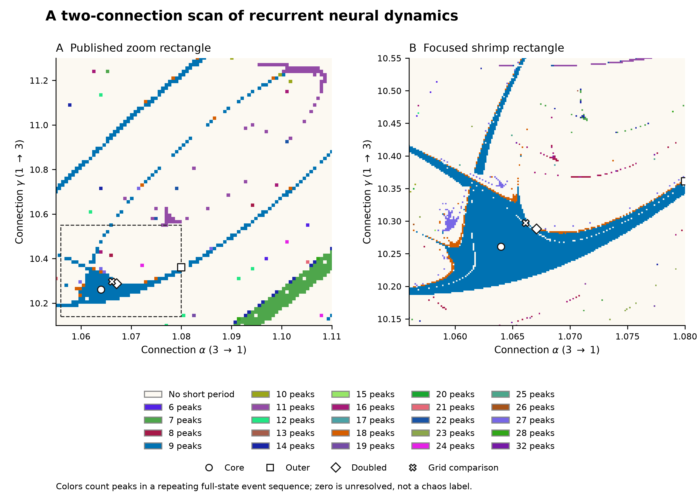
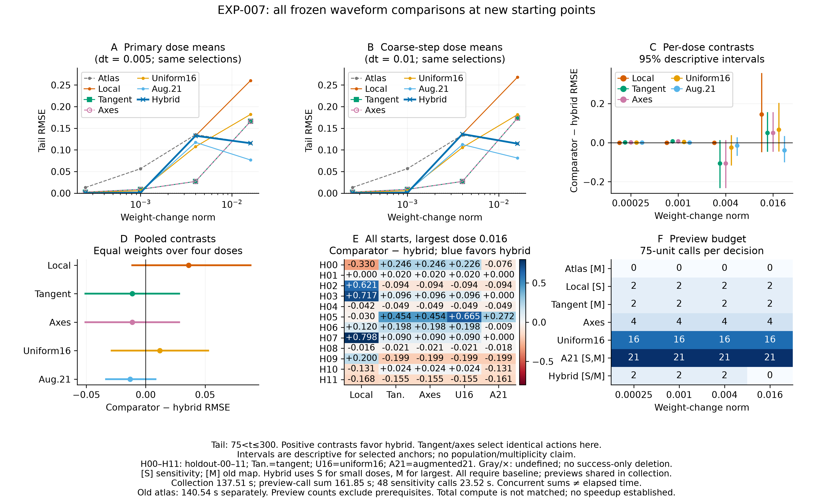

# A neural shrimp and what the network does inside it

**Human-friendly TLDR:** In the tested three-neuron network, shrimp regimes support repeating activity patterns with different responses to disturbances. A signal can persist in deviations away from the cycle, not just in its timing; the selected core attenuates it rapidly, while the selected edge can retain it longer. This connects the dynamics to potential memory and robustness. A special computational advantage from shrimp geometry, and transfer to trained networks, remain unproven.

Private exploratory research on periodic-window geometry, neural activity, and
whether geometric information can improve model control.

**Current release status: private working diagnostic draft.** EXP-008
[PR #7](https://github.com/tdj28/neural-shrimp/pull/7) remains **unmerged**.
Release candidate `1d12ebeda0400c179e54dd36e647a835f7e0d91d` fails strict
Linux verification in both the push and PR workflows. Local replay passed;
two later Linux diagnostics preserve all three penalties and all 288 learned
actions when refitting on **saved features**. Complete cross-platform
reproduction remains unresolved and the strict gate has not passed. The
separate numerical studies below qualify a new retrospective preview-budget
recipe; they preserve the original failures and do not replace that gate.

**Server follow-up, 14 September 2026:** the new saved-trajectory regeneration
audit rebuilds all 3,456 previews and 7,008 targets, then refits on regenerated
inputs. All 288 learned actions, 96 minimum-preview actions and three selected
penalties remain unchanged; all regenerated aggregate waveform scores are
identical to their saved values. Nineteen eigenvalue/coefficient comparison
failures remain. This closes the previous saved-feature-only scope gap without
making the original strict gate pass.

The separately frozen **EXP-009** completes all 2,776 finer/independent
integrations and passes saved-array verification. All 220 distinct actions
chosen by the original policies satisfy its numerical-stability rule; the
baseline-minus-geometry mean becomes 0.000857638, essentially unchanged.
However, 952 of the 1,012 deliberately selected sensitive candidates still
change in RMSE by more than 1e-4 between the two finer native steps, and only
13/19 independent-panel cases meet the declared RMSE-agreement rule; only
12/19 also meet all independent waveform-agreement rules. The selected
control results are robust in this follow-up; many unselected
training labels remain numerically unresolved. This is an outcome-selected
numerical study, not fresh utility confirmation.

The short-preview qualification, **EXP-010**, completes all 6,944 traces.
All 3,456 original 75-unit labels pass the declared native scalar and waveform
checks, all sixteen independent sentinels agree, and all 192 complete candidate
rankings remain unchanged. These shorter labels support the separately frozen
retrospective four-preview development experiment. They do not resolve the
longer candidate outcomes or establish a geometry benefit. See the
[preview qualification audit](docs/EXP-010-results-audit.md).

**EXP-011 completes the four-preview study:** all 24 origin folds and 96 model
recipes pass the frozen numerical gates and built-in replay. Geometry lowers
observed mean preview RMSE from 0.0162661 for shared features to 0.0107899,
but the simple signed-axis control is better at 0.00856899. The full-eighteen
reference is 0.00617504. The shared-minus-geometry contrast is 0.00547615 with
a descriptive origin-bootstrap range of [-0.00265276, 0.01561846]; these
historical origins are development evidence. Both resolutions produce the
same four-entry lists and actions. Geometry is best among the four-preview
policies at the largest radius; local coverage is best at the three smaller
radii. This motivates examination of the quality/cost tradeoff, not a claim
of general geometry utility or net speedup. See the
[shortlist results audit](docs/EXP-011-results-audit.md).

**EXP-012 completes the local GPU qualification:** all 54 batches and 64,188
case integrations finish, but the CUDA path fails the frozen state/metric
compatibility gates and is slower in all 24 warm timing pairs. At the intended
full finer-step batch, median CPU time is 69.69 seconds versus 75.86 seconds
with GPU integration. Tested rankings and repeat/layout bits are unchanged;
those checks do not waive the failed gates. Keep CPU as the scientific default.
Independent saved-evidence audits reproduce the result. See the
[GPU results](docs/EXP-012-results-audit.md).

**EXP-013 completes fresh-origin acquisition but fails cohort qualification.**
All 24 references, 48 sensitivities and 10,608 previews finish. All 3,456 scalar
checks pass, but one candidate fails the preset waveform agreement threshold;
3,455 candidates, all 48 shams and all 48 independent-panel cases qualify.
Independent audits reproduce this result. The frozen rule withholds full-cohort
loss means and intervals. The separate numerical diagnostic and direct timing-memory acquisition
are now complete; their distinct qualification limits are recorded below. See the
[fresh-origin results](docs/EXP-013-results-audit.md) and
[current project assessment](docs/project-assessment-2026-09-17.md).

**EXP-014 completes acquisition; numerical qualification fails.**
All 930 jobs finish. Thirty full-trace comparisons fail at the largest pulse
size, although all bounded bit-readout accuracy comparisons agree. Both
setting averages remain withheld: a saturated readout can hide large
trajectory differences. One numerically consistent individual phase-null
case agrees with the full-linear model and differs from the phase-only
prediction, motivating study of transverse response and forgetting rates.
The probabilities assume Gaussian measurement noise; they are not noisy-trial
accuracies. See [the timing-memory audit](docs/EXP-014-results-audit.md).
The separate [EXP-013 finer-step diagnostic](docs/EXP-013-refinement-results.md)
supports its original finest-step trace, while preserving the original failed
cohort qualification.

**EXP-014 refinement completes all 425 tighter-solver traces.** All five new
methods agree in 77/85 selected cases, including all smaller-pulse controls
and shams. Eight large-pulse cases remain unresolved; nearly unchanged binary
accuracy still hides large trajectory and signed-readout differences.
Original settings remain unqualified. See
[the refinement results](docs/EXP-014-refinement-results.md) for the full census,
independent audit and retained strict arithmetic-replay failures.


**EXP-015 completes all 192 phase/transverse decomposition cells.** All 64
phase-null cells pass the frozen checks: their predicted readout is transverse. Core signals
strongly attenuate; near-edge signals persist and can grow across sampled windows. Overall, 191 cells pass algebraic
consistency and 179 pass the ideal-neutral approximation; every failed gate
is retained. Independent alternate arithmetic retains additional strict
discrepancies. This explains a local memory mechanism conditional on the saved
propagators, without establishing shrimp-specific or trained-network benefit.
See [the decomposition results](docs/EXP-015-results.md).

**The authorized Astra Pro strategy consultation is complete**, with a
conservative receipt-derived cost of **$0.78126**. Its
[adjudicated recommendation](docs/consults/2026-09-17-pro-adjudication.md)
is to test whether the earlier input remains readable after a second input
interferes with it. The [two-write experiment](docs/two-write-memory-design.md)
is under implementation, with full numerical and simple-model controls;
no new two-write neural outcome is claimed.

Read the [arithmetic diagnosis](docs/EXP-008-arithmetic-results-audit.md),
[regenerated-input audit](docs/EXP-008-regeneration-results-audit.md),
[EXP-009 results](docs/EXP-009-results-audit.md), and
[updated next steps](docs/next-steps.md). New bulky raw outputs live in
`../neural-shrimp-data/`; code, protocols and compact hash-bound summaries
remain in this private repository. See [Skills.md](Skills.md).

**EXP-004 maps a shrimp-shaped periodic region and verifies selected full-state
cycles in a three-neuron recurrent neural network.** Full boundary organization
remains unfinished. This is the fixed-weight tanh system
reported by da Silva and Rech (2022), not a newly trained modern network. The
network's three potentials evolve while two connection weights define the map.



The frozen experiment measured **39,322 grid settings and 201 independently
initialized transect points**. Smaller-step, longer-settling checks and
independent DOP853 shooting verified two nine-peak cycles and a nearby
eighteen-peak cycle. At the core, the full state repeats after
**37.63637538 time units**, with relative closure **7.46e-10**. The flow has its
required neutral multiplier; the dominant transverse multiplier is **0.06506**.

The shape therefore corresponds to something the parent network actually does:
a repeating three-neuron activation waveform with a definite period and local
transverse stability. Aligned maps and an independent transect show its
relationship to finite-time sensitivity and actual tanh-activation variability.
The activation readout preserves the complete waveform's period; saturation
compresses some amplitude differences.

A useful failure remains visible. The point selected as an exterior by the
coarse grid becomes a nine-peak candidate at both refinement steps. EXP-004
retains that failed interpretation. **EXP-005 independently certifies a
nine-peak orbit at the same coordinate**; it does not overwrite the failure.

The separately frozen [EXP-005 follow-up](docs/EXP-005-protocol.md) starts all
four controls independently, settles for 10,000 time units, and measures for
2,000 at both `dt=0.01` and `0.005`. The lower and upper transect endpoints
remain irregular under its finite-horizon rule: no detected short period and
positive finite-time exponents at both steps. After a **1e-6 state perturbation
and 300 time units**, the actual activation-vector separation is **1.53e-6 at
the core versus 1.41 and 2.13** at those two controls. This is a large measured
difference in neural waveform repeatability, without an asymptotic-chaos or
task-accuracy claim.

Read the [numerical working paper](paper/neural-shrimp-working-draft.pdf)
([LaTeX](paper/main.tex)), [EXP-004 protocol](docs/EXP-004-protocol.md),
[exact manifest](experiments/hopfield/EXP-004-plan.json), and
[display amendment](docs/EXP-004-display-amendment.md). Figures contain measured
ODE outcomes, with lossless plotted-array archives and source/output receipts.
This reproduces known small-network dynamics; it does not establish novelty,
exact bifurcation boundaries, trained-task accuracy, or an optimization benefit.

## Does the geometry help preserve a useful output?

**EXP-006 gives a mixed, dose-dependent answer for a defined neural waveform task.**
All 12 attempted anchors qualified and all 4,320 planned trial-step records are
complete. The task measures error in all three activations during the first
300 time units after a held connection-weight change, allowing one constant
phase offset for the whole record. Competing directions have equal native
weight norms. The declared local comparator uses actual local weight
sensitivity; its two direction signs are averaged without selecting the better
outcome. The atlas policy uses only the earlier parameter map.

At the largest tested radius, **0.016**, atlas RMSE is **0.301672 versus 0.466653**
for symmetric local sensitivity, about **35.4% lower**. The paired benefit is
0.164981, with a descriptive anchor-bootstrap 95% interval [0.013853, 0.326023];
8 of 12 anchors favor the atlas. **At both smallest radii, local sensitivity wins
at every anchor.** The prespecified contrast averaged across all four radii is
0.025738 [−0.027862, 0.083081], leaving the aggregate advantage over local
sensitivity unresolved. These intervals describe the fixed selected anchors;
they are not population or confirmatory claims.

The atlas is **not the best observed arm**: the `tangent_plus` diagnostic has lower
mean error at every dose, including 0.260795 versus 0.301672 at radius 0.016.
That exploratory arm comparison must inform the next frozen baseline set; it
does not replace the prespecified primary comparison after outcomes.

Eventual nine-peak retention is 188/192 for the atlas and 308/384 across both
local signs. This separate assay follows 10,000 settling and 2,000 measurement
time units. **Eventual nine-peak retention does not guarantee immediate waveform
preservation.** The frozen example, `anchor-08`, favors both local signs over the
atlas, although every displayed arm eventually has nine peaks. It remains the
illustration. Transients, phase, frequency, and shape can all affect the short
waveform error; their contributions have not been isolated.

The new figures retain favorable and unfavorable cases:

- [All anchor attempts and atlas margins](paper/figures/neuralshrimp-drift-anchors.png).
- [Waveform error, all arms, and paired benefits](paper/figures/neuralshrimp-drift-utility.png).
- [Frozen waveform example that favors the local comparator](paper/figures/neuralshrimp-drift-waveforms.png).
- [All four continued branches and transverse stability](paper/figures/neuralshrimp-drift-continuation.png).

Independent pseudo-arclength continuation retains 196 node records, including
122 unstable records and five failed corrections. These include overlapping
branches and repeated seeds, not 196 distinct cycles. Geometric shooting checks
agree at 27/28 checkpoints. One checkpoint fails the unchanged closure threshold
(1.0591e-8 against 1e-8) and remains failed. Candidate multiplier crossings and
parameter reversals are not exact bifurcation boundaries.

Read the [EXP-006 protocol](docs/EXP-006-protocol.md),
[utility audit](docs/EXP-006-utility-results-audit.md),
[continuation audit](docs/EXP-006-continuation-results-audit.md), and
[complete evidence](evidence/EXP-006/attempt-001/receipt.json).
EXP-007 below executes the next one-step comparison. Neither an optimization
speedup nor trained-model transfer follows from the fixed-network task. See
the [concrete next steps](docs/next-steps.md).

## Stronger controls at new starting weights: EXP-007

**The proposed hybrid does not establish a resolved advantage.** A separate
prospective freeze tests 12 new starts outside exclusion neighborhoods of the
old anchors, with four new orbit phases. All **4,032 previews and 2,784 target
evaluations** complete. Policy selection uses simulator time 0–75; primary
waveform scoring uses 75.1–300. This is a new-intervention test on the known
atlas, not an unseen network or independent future time sample.

At the largest radius, hybrid RMSE is **0.115448 versus 0.260336** for signed
local sensitivity, but the paired interval **[−0.045524, 0.353194] includes
zero** and only 6/12 anchors favor hybrid. Augmented search has lower mean
error, 0.076644. Every primary pooled comparison is unresolved. The frozen
example again favors local over hybrid and remains in the paper.

The tangent and coordinate policies select **exactly the same actions in
192/192 conditions**: changing gamma while holding alpha fixed. Their 384
coarse/fine target arrays are identical. Their performance here supplies no
independent evidence that detailed shrimp geometry is needed. This is a useful
explanation of the apparent tangent benefit, not a reason to deny the measured
rhythms or claim gamma-only updates are universally best.



The manuscript now has three additional empirical plates:
[new starts and exclusion neighborhoods](paper/figures/neuralshrimp-holdout-anchors.png),
[all policy comparisons](paper/figures/neuralshrimp-holdout-utility.png), and the
[frozen waveform example](paper/figures/neuralshrimp-holdout-waveforms.png).
Read the [protocol](docs/EXP-007-protocol.md),
[independent results audit](docs/EXP-007-results-audit.md), and
[complete receipt](evidence/EXP-007/attempt-001/receipt.json).

## Prediction improves; action utility remains unresolved: EXP-008

**Adding the old map lowers observed prediction MSE by 17.17%, but does not
establish a better action selector.** A separately frozen experiment uses all
12 EXP-007 origins for development and 12 new test origins, two quarter-cycle-
separated phases, and the same 18 candidate actions and previews for every
policy. All **3,456 previews and 7,008 target/sham records** complete. Model
fitting uses development data only; all test choices are sealed before test
target collection. The later waveform task remains `75<t<=300`.

| Fine-step pooled outcome | Shared baseline | + Real geometry | + Mismatched geometry | Minimum preview |
|---|---:|---:|---:|---:|
| Selected activation RMSE | 0.017824 | 0.016966 | 0.016402 | **0.009959** |
| Finite-18-action regret | 0.010591 | 0.009733 | 0.009169 | **0.002726** |
| All-candidate prediction MSE | 0.022641 | **0.018753** | 0.024347 | Different endpoint |

The primary paired benefit from geometry is **0.000858**, with descriptive
95% interval **[-0.007701, 0.006545]**; eight test blocks favor geometry, three
favor the baseline, and one ties. Prediction MSE is a secondary outcome and
does not replace this unresolved action-utility result. The finite candidate
oracle cancels from paired regret differences, so regret supplies no second
independent confirmation. **Direct minimum-preview selection has 41.30% lower
mean error than the geometry learner**, using the same 18 forecasts; its
diagnostic contrast interval excludes zero in these selected blocks.

The numerical limitations remain visible. Across all 3,504 coarse/fine pairs,
the median RMSE change is 2.91e-7 but the maximum is **0.476851**: candidate
outcomes and training labels are not uniformly converged. Selected-policy
scores are steadier (maximum 0.001000), and the pooled conclusion agrees at
both steps. Independent local SVD reconstruction exceeds the unchanged coefficient
tolerance for eight baseline and eight mismatched-model coefficients; all
chosen penalties and actions nevertheless agree. This failed comparison is
retained, alongside successful **local** frozen replay and independent local
raw/feature checks. Negative regression scores were not clipped or rescored.

Linux release checks reveal additional portability failures. PR run
**34803148459** reaches the fit comparison and fails baseline coefficient `[1]`
with absolute difference **3.68269315e-8**, beyond the combined
`rtol=1e-7, atol=1e-9` check. Push run **34803133930** stops earlier at shared
feature `[34]`, with absolute difference **1.39784018e-14**, beyond its combined
`rtol=1e-12, atol=1e-14` check. The PR run reaches fitting after its waveform
checks; the push run does not finish the feature/waveform loop.
Exact [PR failure](docs/EXP-008-linux-pr-failure.txt) and
[push failure](docs/EXP-008-linux-push-failure.txt) logs are retained.

Later Linux diagnostics at `bb4ecd25cf5c025064e7bd200b6acd898953d0e5`
([PR 34804593644](docs/EXP-008-platform-linux-pr.json),
[push 34804589708](docs/EXP-008-platform-linux-push.json)) pass exact evidence
bindings and preserve **all three penalties and all 288 learned actions using
saved-feature refits**. Maximum prediction differences are 1.3874261184e-9
and 1.9615957192e-9, below the minimum saved action-score gap of
3.7010270022e-6. Saved-model score replay passes `rtol=1e-12, atol=1e-14`.
The PR diagnostic retains two shared-feature failures and 8 baseline plus 9
shuffled coefficient failures; the push retains zero shared-feature failures
and 10 plus 10 coefficient failures. Geometry coefficients pass in both.
This bounded agreement does not cover a refit from completely regenerated
inputs or new integrations. The diagnostic does not repeat waveform metric
checks, replace the strict gate or establish general portability; see the
[platform status](docs/EXP-008-platform-status.md).

The three new plates show [all origins, blocks and feature coverage](paper/figures/neuralshrimp-information-map.png),
[all policies, paired effects, regret and development tuning](paper/figures/neuralshrimp-information-utility.png),
and the [frozen first test example](paper/figures/neuralshrimp-information-waveforms.png).
Every policy chooses candidate 4 in that example, so its curves coincide; no
more favorable illustration is substituted. Read the
[protocol](docs/EXP-008-protocol.md), [raw-data audit](docs/EXP-008-results-audit.md),
[independent model audit](docs/EXP-008-model-results-audit.md),
[generated summary](evidence/information-paper-summary.json), and
[receipt](evidence/EXP-008/attempt-001/receipt.json).

The four-preview question has now been tested retrospectively in **EXP-011**.
The simple controls are essential: signed axes have lower pooled error than
either learner, while geometry's observed increment over shared features is
uncertain and varies with radius. The next study must specify a useful quality
margin and measure prerequisite costs before claiming that fourteen fewer
preview calls save total work. Short-preview error and 300-unit waveform
preservation remain separate endpoints. See [next steps](docs/next-steps.md),
the [frozen protocol](docs/EXP-011-protocol.md) and
[results](docs/EXP-011-results-audit.md). No trained-model benefit,
topology-specific mechanism or net speedup is established.

The [new unreviewed dynamical-memory preprint](https://arxiv.org/abs/2609.07341v1)
is documented in a [critical reading note](docs/literature/2026-09-11-aguilera-demartino.md).
It motivates a separate crosstalk hypothesis. Its capacity results have not been
replicated here; the note includes executable checks of printed inconsistencies
and distinguishes encoding spectra from orbit stability.

## Implemented instruments

- Native continuous-time three-neuron tanh integration, complete-state peak
  recurrence, tangent sensitivity, and all-neuron state/activation statistics.
- Independent adaptive shooting with primitive-period, complete-state closure,
  neutral-flow, and transverse-Floquet checks.
- Native-weight sensitivity, one-global-phase waveform comparison, a matched
  eleven-direction utility design with shams, and failure-retaining analysis.
- Pseudo-arclength continuation through stable and unstable orbit segments,
  transverse Poincaré spectra, and independent shooting checkpoints.
- Frozen row-wise evidence, independent-initialization transects, step and
  settling refinements, and paired perturbation traces.
- Deterministic figure generation with exact plotted values and source hashes.
- Development-only ridge fitting, grouped validation, sealed test decisions,
  an exhaustive finite-action oracle, and independent raw/model audits.
- Earlier full-batch tanh training maps, gradients, Hessians, and Jacobians;
  Hénon/logistic controls; fixed/scheduled/stagnation/recurrence policies.
- Offline RunPod packaging and watchdog preparation. Current experiments use
  local CPU resources; GPU and provider-lifecycle automation are not validated.

## Reproduce and verify

Dependencies are pinned by `uv.lock` and the hashed `requirements.lock` export.
From a clean clone:

```sh
uv sync --frozen --extra dev
uv run --frozen pytest -q
uv run --frozen python tools/run_hopfield.py validate
```

Existing EXP-004--006 evidence and figures can be checked without advancing the ODE:

```sh
uv run --frozen python tools/run_hopfield.py verify \
  --output evidence/EXP-004/attempt-001
uv run --frozen python tools/plot_hopfield.py evidence/EXP-004/attempt-001 \
  --destination paper/figures --check
uv run --frozen python tools/run_hopfield_controls.py verify \
  --output evidence/EXP-005/attempt-001
uv run --frozen python tools/plot_hopfield_controls.py evidence/EXP-005/attempt-001 \
  --destination paper/figures --check
uv run --frozen python tools/run_hopfield_drift.py verify \
  --output evidence/EXP-006/attempt-001
uv run --frozen python tools/plot_hopfield_drift.py evidence/EXP-006/attempt-001 \
  --destination paper/figures --check
```

The plotting commands re-derive plots from saved measurements. `--verify` also
requires byte-identical image regeneration in the same library/font environment.
No source outcome is changed by rebuilding the figures.

EXP-007 and EXP-008 saved evidence can be checked with:

```sh
uv run --frozen python tools/run_hopfield_holdout.py verify \
  --output evidence/EXP-007/attempt-001
uv run --frozen python tools/plot_hopfield_holdout.py evidence/EXP-007/attempt-001 \
  --destination paper/figures --check
uv run --frozen python tools/run_hopfield_information.py verify \
  --output evidence/EXP-008/attempt-001
uv run --frozen python tools/audit_hopfield_information.py \
  --out /tmp/EXP-008-independent-check.json
uv run --frozen python tools/audit_information_models.py evidence/EXP-008/attempt-001 \
  --out /tmp/EXP-008-model-independent.json
uv run --frozen python tools/plot_hopfield_information.py evidence/EXP-008/attempt-001 \
  --destination paper/figures --check
```

These EXP-007/008 figure checks verify existing output hashes and re-derived
arrays; they do not require byte-identical rendering on a different platform.
The independent model report deliberately retains its coefficient-tolerance
failures while checking unchanged selections. No audit output belongs inside
an immutable experiment attempt.

Fresh target execution requires clean source, a pushed source commit, a frozen
plan, and a new attempt directory. Never overwrite a consumed plan or reset an
attempt. The original EXP-004 used four CPU workers and 140.54 seconds of
measured wall time; EXP-005 used one worker and 4.17 seconds. EXP-006 was frozen
at `ddb568e6cd67ef2cfbdb45e05710cd86025ef548` and used 423.866 seconds for collection
and analysis, excluding its final verification pass. Its 48 local sensitivity
solves took 26.627 seconds **within** that time. The old atlas's 140.54 seconds
is a separate cost, not free information. Paid compute and paid review spend
were zero. The source-freeze CI passed with 136 tests. Integrated evidence and manuscript
revisions are checked by the repository workflow; current run status is retained
in GitHub.

EXP-008 ran from pushed source `3c5604497ec57b19d62fbb595da7b190102f4b33`,
preserved as `archive/EXP-008-source-v1`. Collection and summary took **162.352
seconds**, excluding final verification. Sensitivity used 23.770 seconds and
fit/seal writing 0.079 seconds within that clock. The old map's 140.54 seconds
is separate. The complete local source-freeze suite passed 249 tests; the
current Linux release checks fail and PR #7 remains unmerged. Paid compute and review
spend remain zero.

To build the paper, run `pdflatex main`, `bibtex main`, then `pdflatex main`
twice from `paper/`. The two main parameter maps and the four-control plate use
landscape pages for readability; references resolve to primary sources.

## Earlier pilot history

EXP-001–003 are preserved separately. The Hénon control verified periodic
orbits, the coarse neural **training** scan found no verified cycles, and the
recurrence-triggered policy never acted. Those results neither established a
neural shrimp nor an optimization advantage. See the [retained evidence](evidence/README.md)
and [initial results](docs/initial-results.md).

The earlier [figure guide](docs/visual-revision.md),
[exact scalar-cycle derivation](docs/analytic-cycle.md), and
[observable-consequences plan](docs/observable-consequences.md) remain as research
history and proposed methods. Their conceptual diagrams are not the numerical
shrimp reproduced in EXP-004.

Paid research reviews require explicit approval for each request. See the
[compute plan](docs/compute-plan.md) before considering paid resources. This
repository remains private until its owner authorizes publication.
