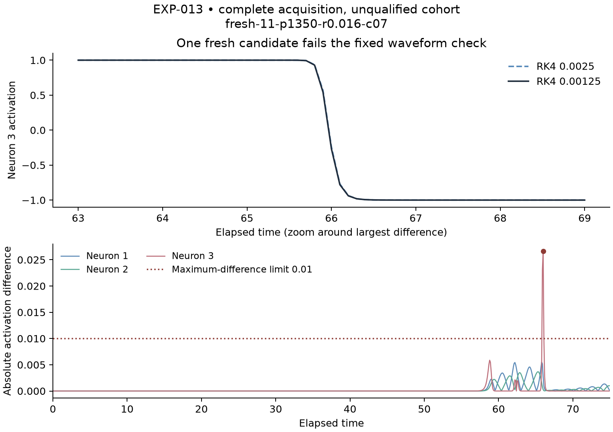

# EXP-013: complete acquisition, failed cohort qualification

The fresh-origin experiment completed all 10,681 staged tasks on 17 September
2026. All 24 new reference orbits and 48 sensitivities qualify. All 10,608
preview integrations and 6,144 policy readouts are preserved. One of the 3,456
candidates fails the fixed native waveform comparison. The frozen rule therefore
withholds full-cohort loss averages and bootstrap intervals. This run does not
resolve whether geometry improves the preview-budget tradeoff.

## What failed

`fresh-11-p1350-r0.016-c07` passes scalar refinement: the two successive RMSE
differences are 0.000145253751187 and 0.000013842566721. However, the activation
RMS difference between `dt=0.0025` and `0.00125` is 0.0010433789484 against
0.001, and the maximum difference is 0.0266502881583 against 0.01. The maximum
occurs at elapsed time 66.0 in neuron 3. All 3,456 scalar comparisons, 3,455
candidate waveform comparisons, 48 shams and 48 independent-panel cases pass.

The candidate ranks last of eighteen at both saved resolutions, appears only
in the full-eighteen list, and is selected by no policy. The full-eighteen
winner is candidate 17. These are saved-case diagnostics, not grounds to waive
the prospective full-census qualification rule. A separately frozen, explicitly
outcome-selected finer-step diagnostic is being prepared for this candidate
and its matching zero-dose sham. It cannot retroactively change this result.

## Evidence and chronology

Initial attempt 001 stopped after fitting/sealing the old-data models, before
fresh dynamics, because of an event-log keyword collision. Its failure and
full unavailable-task ledger remain preserved. The original verifier also
encountered a Python/NumPy string serialization mismatch; independent normalized
model replay reproduced every numeric value exactly. The explicit
[operational amendment](EXP-013-operational-amendment.md) added a separate
recovery runner and preserved the initial frozen sources and scientific gates.

Recovery attempt 002 ran from privately pushed commit
`e5864f93ec6e822ba4fc6670640149f4a7c07b7b`, with plan SHA-256
`23fa73be0a2cbb7cc39247f32cbcf956a34c548a52c6e8efc6a8b79f8651793f`.
The four old-origin model recipes were sealed before fresh dynamics; fresh
features/predictions/shortlists preceded previews; all 5,760 non-full winners
were sealed before full-eighteen oracle access. The acquisition and analysis
scope took 313.576 seconds on four bounded local CPU workers; final receipt
inventory/postflight work is outside that timer. No paid compute was used.

## Verification

The recovery CLI verifier reproduces all 10,608 score packets and all four
model recipes, including the complete-but-unqualified conclusion. A separate
saved-evidence audit passes 1,075,439 checks, with zero score differences and
zero discrepancies. It reconstructs qualification arithmetic, artifact/source
bindings, task identities and cleanup; it reuses the unchanged waveform-score
primitive, and does not claim independent reintegration. A separate pure-Python
decision/cost audit passes 68,600 checks across 6,144 readouts, 5,760 winners and
6,944 fixed amortization blocks. Both audits preserve unavailable cohort means.
All recorded task-owned process identities are absent after completion.

The immutable raw directory is
`/data2/neural-shrimp-data/raw/EXP-013/attempt-002/`: 21,495 artifacts,
504,145,856 bytes. Its receipt SHA-256 is
`058aa80de824ecdfa00d8abc77d85ff231353a2af60e8db932f39eb07936552e`.
[The compact receipt](EXP-013-summary.json) binds the raw inventory, summaries,
audits and plotting script. This sibling storage is retained local evidence;
an independent external-data backup has not been verified. Git protects the
code and compact receipts. PR creation remains pending GitHub API authentication;
no main merge or original EXP-008 gate override occurred.
