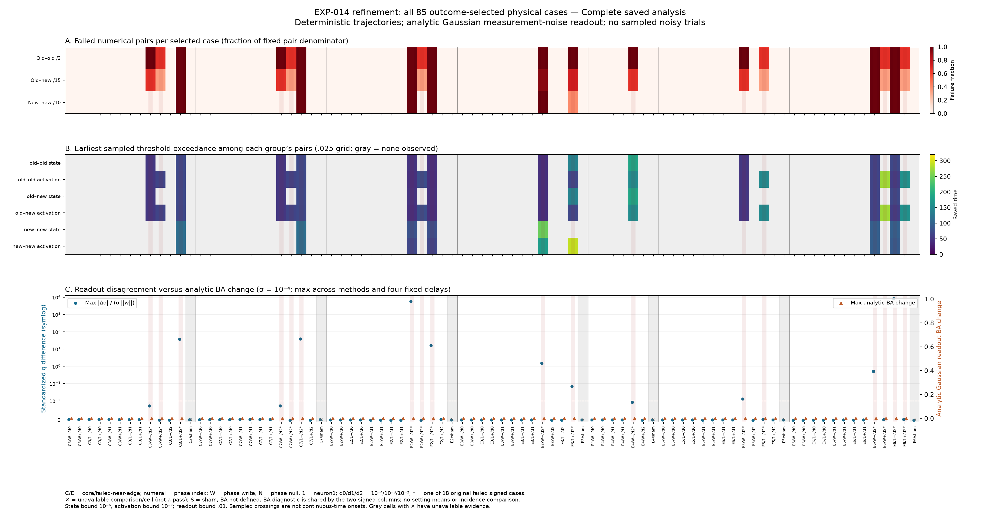

# EXP-014 refinement: smaller pulses agree; eight large-pulse cases remain unresolved

17 September 2026. All **425 new trajectories** complete with unchanged source
and no producer error. All five new methods agree under the frozen diagnostic
gates for **77 of 85 selected physical cases**, including ten of the eighteen
originally failing signed cases. Eight large-pulse cases still disagree.
Both original EXP-014 settings remain unqualified; no setting mean is reported.

This is the explicitly outcome-selected [85-case follow-up](EXP-014-refinement-protocol.md),
with both signs at all three doses for every affected binary context and seven
matched shams. No new outcomes informed its selection or thresholds. The
[amendment](EXP-014-refinement-design-amendment.md) preserves the earlier incomplete
signed-case proposal. Numerical methods are checks, not independent subjects.

## Complete results

| Method-pair group | Required and complete | Pass | Fail |
|---|---:|---:|---:|
| Original–original | 255 | 207 | 48 |
| Original–new | 1,275 | 1,090 | 185 |
| New–new | 850 | 776 | 74 |
| All | 2,380 | 2,073 | 307 |

The 48 original–original failures include the additional coarse-RK4/DOP853
comparison, beyond the original study's two comparison types. They do not
replace or revise its recorded 30 failures. All 680 old/new score packets and
3,744 same-method binary readout cells are present.

All **52 smaller-dose cases** pass every one of the 28 method comparisons.
All seven sham cases also pass; all 56 sham traces and 224 clock readouts meet
the original absolute-bias gate (maximum standardized bias 0.00153041).
Sixty-seven cases pass every old/new comparison, while 77 pass all ten new–new
comparisons. These are counts in a deliberately selected panel, not population
success rates or a comparison of core-versus-edge incidence.

The eight cases below all use pulse norm 0.01. Seven fail every new–new pair;
one fails only comparisons involving the coarsest new RK4 step, 0.000625.

| Setting | Original phase index | Direction | Sign | Failed new pairs / 10 |
|---|---:|---|---:|---:|
| Core | 3 | Neuron one | + | 10 |
| Core | 7 | Neuron one | − | 10 |
| Near edge | 2 | Neuron one | − | 10 |
| Near edge | 2 | Phase writing | − | 10 |
| Near edge | 3 | Neuron one | + | 4 |
| Near edge | 3 | Phase writing | − | 10 |
| Near edge | 6 | Neuron one | − | 10 |
| Near edge | 6 | Phase writing | − | 10 |

Across new–new comparisons, maximum potential discrepancy is **4.20159**,
activation discrepancy **1.73125**, and standardized signed-readout discrepancy
**2,853.79**. The two tighter DOP853 arms still fail agreement in seven cases;
their worst discrepancies are 0.333731 in potential, 0.192387 in activation and
68.3724 readout-noise standard deviations. Thus selecting one finest native
step or one adaptive solve would not resolve the remaining uncertainty.

The earliest new–new activation threshold crossing is at saved time 67.475;
the latest first crossing is 291.15. These describe the .025-spaced saved grid,
not certified continuous-time onsets. All trajectories retain the full
320-unit horizon. No convergence order, chaos, basin escape or new attractor
is established by these disagreements.

## Saturated accuracy hides disagreement

For every one of the eight cases failing new–new comparison, the binary
balanced accuracy has **zero method spread at primary noise**. Across all
selected binary contexts and all eight methods, its maximum primary-noise
spread is only 1.37227e-6, while the maximum standardized signed-readout
discrepancy is 8,431.35. Across all three noise levels the maximum accuracy
spread is 7.75113e-5. Probabilities near zero or one can conceal large changes
in the underlying signed means.

These probabilities are analytic under the stipulated independent Gaussian
measurement-noise model, with the original frozen clock and orientation.
They are not results from sampled noisy trajectories or a trained classifier.
Accuracy agreement cannot waive full-state, activation or unsaturated-readout
failures. The figure retains all selected cases, controls and method groups.

## Execution, verification and limitations

The exact reviewed source was committed and privately pushed **before** target
acquisition: `67be43cc5ed821543bca384eaf574dbff26d73f3`. Plan SHA-256:
`150e18cf4b528ea8740e498a2cc610454e7f313dcce482a6a4735e0016104bfe`.
Independent preflight passed 1,690 checks and 59 synthetic tests; root separately
passed the same 59 tests. All 27 prior frozen source bindings were unchanged.

Producer and analysis time was **227.755 seconds**, including 178.036 seconds
of acquisition and 32.867 seconds of saved-array analysis. Four CPU workers
used at most 4,683,366,400 bytes of monitored summed RSS; host available RAM
remained at least 74,633,646,080 bytes. No paid compute or GPU allocation was
used. All 425 worker identities and the producer were verified absent after
completion. Sampling does not establish a zero-overshoot resource bound.

The frozen saved-array verifier passes. The separate independent auditor
passes **271,702 evidence and scientific-decision checks**, with no hash,
identity, crossing-time, gate-decision or classification mismatch. Its
**strict alternative-arithmetic replay fails 1,375 of 134,168 checks**:
1,372 standardized pair differences and three sham-bias values. Maximum
absolute difference among failed comparisons is 6.49762e-12. The original
arithmetic tolerances remain unchanged; this is not an overall strict-audit
pass. No original EXP-014 audit failure is erased.

The report helper and independent auditor are now backed up in Git; 41
integrated reporting/audit synthetic tests pass. The reporter checks hashes
and saved summaries; it is separate from the raw-array audit. The root also
visually inspected the actual diagnostic figure.

Immutable raw evidence lives at
`/data2/neural-shrimp-data/raw/EXP-014-refinement/attempt-001/`: 1,295 artifacts,
211,402,685 bytes. Receipt SHA-256:
`23ade00539cb1a138dbac3afc64e183b306f34d108beb7e6f58873b4c062243e`.
The [compact summary](EXP-014-refinement-summary.json) binds the receipt,
verifier, independent checks, interpretation and exported reports.

## Scientific decision

This localizes the original numerical problem: the smaller pulses and shams
agree, ten formerly failing signed cases now have a mutually consistent new
method group, and eight large pulses remain unresolved. It supplies no
original-setting average or shrimp-specific computational advantage.

The existing individually consistent phase-null example remains a reason to
study transverse contribution to memory. A pre-outcome local decision note
proposes a separately frozen **192-cell saved-reference phase/transverse gain
decomposition**, covering every original setting/phase, direction and clock
window ([saved design note](phase-transverse-gain-next-design.md)). It can examine local mechanisms without requiring a trustworthy
large-pulse trajectory or another ODE sweep. It has not yet been executed.
Full boundary organization, matched geometry controls and an actual trained
network task remain separate requirements; see the
[literature bridge](neural-memory-literature-bridge-2026-09-17.md).
