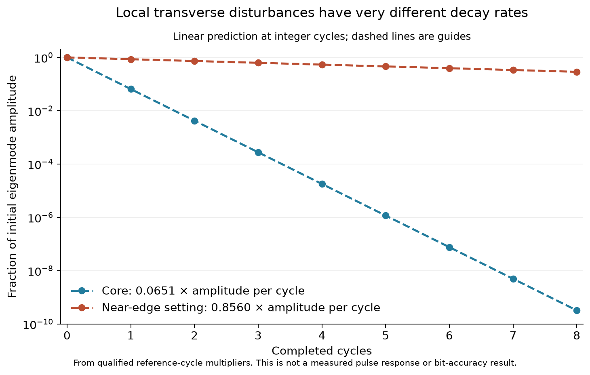
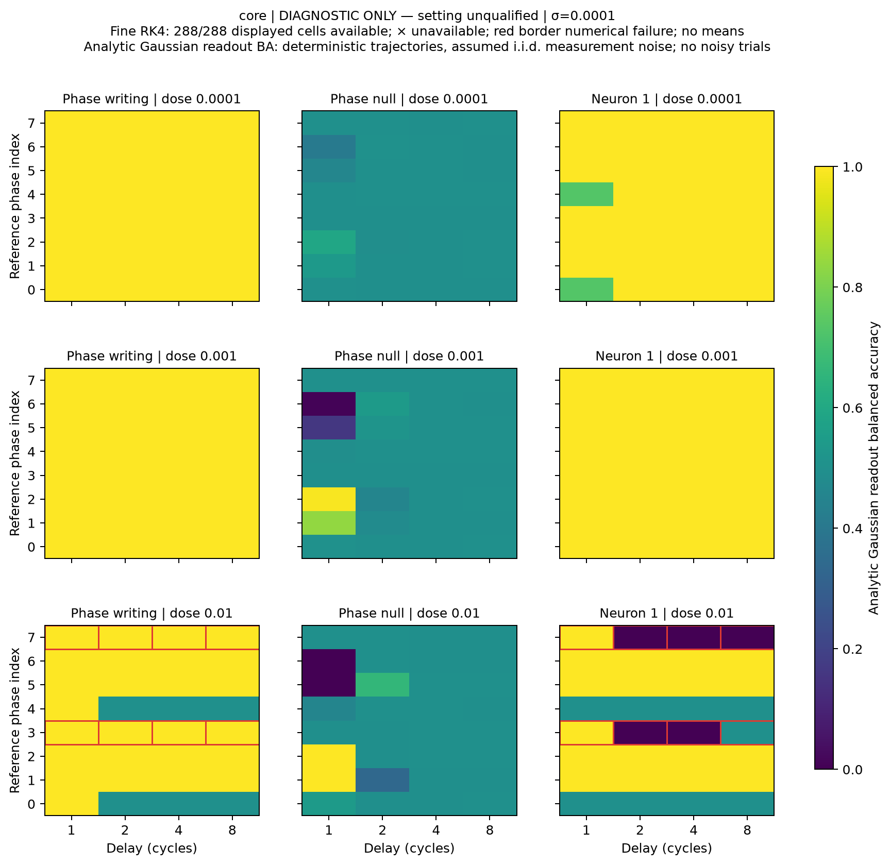
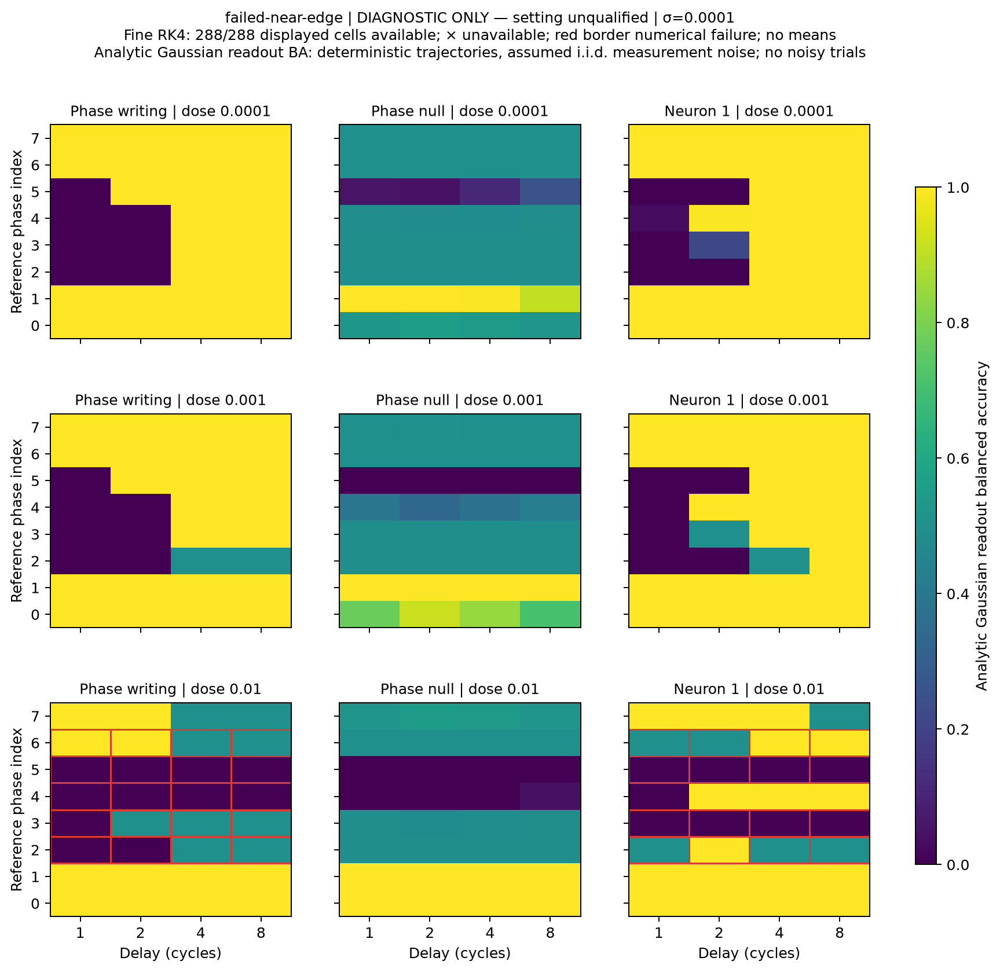

# EXP-014: complete timing-memory acquisition, unresolved large-pulse trajectories

All 930 planned tasks complete: two reference recertifications, sixteen
phase propagators and 912 pulse/sham trajectories. Both settings remain
numerically unqualified. Thirty of 608 full-trace method comparisons fail,
all at the largest pulse magnitude, 0.01. The setting-level averages remain
withheld. These results motivate a numerical follow-up rather than a broad
memory or geometry-utility claim.

## What the checks reveal

| Check | Core | Previously misidentified near-edge control |
|---|---:|---:|
| Trace comparisons attempted | 304 | 304 |
| Failed comparisons | 10 | 20 |
| Coarse RK4 / fine RK4 failures | 6 | 12 |
| Fine RK4 / DOP853 failures | 4 | 8 |
| Maximum potential disagreement | .0285252 | 23.6818 |
| Maximum activation disagreement | .0176580 | 1.99999989 |
| Maximum standardized signed-readout disagreement | 36.5491 | 5777.8931 |

All prerequisites, zero-input shams, smaller-dose comparisons and phase-null
comparisons pass. Failures involve eighteen signed largest-dose cases, across
thirteen binary input contexts and seven setting/phase contexts. Eleven failing
signed cases use phase-writing inputs and seven use ordinary neuron-one inputs.
No case is removed from either setting's qualification denominator.

**All 3,456 analytic balanced-accuracy comparisons nevertheless pass.** The
bounded classification score can saturate at zero, one-half or one while its
underlying unsaturated readout and trajectories disagree strongly. Agreement
in that score alone therefore cannot establish reliable neural dynamics or
memory performance. The fixed full-state and activation checks caught this.
The largest activation disagreement spans almost the full tanh output range.
It does not by itself establish chaos, a basin boundary or an attractor escape.
Accuracy near zero indicates a response opposite the frozen decoder’s orientation; it does not prove
that the trajectories contain no binary information. Reversing labels or
refitting the decoder after outcomes would define a different endpoint.

## A concrete mechanistic diagnostic worth following

One selected individual case passes its required numerical comparisons:
near-edge setting, phase 1, pulse magnitude 1e-4, phase-null direction, four
cycles and measurement-noise sigma 1e-4. Its analytic balanced accuracy is
0.9929902094, compared with 0.5 for the sealed phase-only prediction and
0.9929902142 for the sealed full-linear prediction. This is consistent with
a transverse linear response contributing to the readout at four cycles.
The near-edge cycle's transverse multiplier radius is 0.856033, versus
0.0650601 at the core. Different decay rates make this a useful question
about the network's dynamics; the scalar radii alone do not prove the cause.

For the corresponding infinitesimal eigenmode, the per-cycle magnitudes
predict about 0.00179% remaining after four cycles at the core versus 53.7%
near the edge. These are local linear predictions for that eigenmode, not
measured pulse amplitudes, whole-state contraction bounds or bit-retention
probabilities. Intra-cycle amplification and projection onto the readout matter.

This case was chosen after viewing outcomes. It is an individual diagnostic,
not a qualified setting average, an independent network replication, or an
advantage caused by shrimp topology. The readout assumes an external phase
clock and independent Gaussian measurement noise on activation samples.
The reported probabilities are computed analytically from deterministic
trajectories; they are not accuracies measured in noisy trials.

The figures retain every primary-noise cell and mark affected numerical
comparisons in red. Other noise levels, phase-only differences, all-method
rows and figure receipts are retained in the external report. No unqualified
setting means are plotted.

## Acquisition, recovery and verification

Attempt 001 stopped at its 2 GiB summed-RSS limit after seven completed pulse
traces. Its [compact receipt](EXP-014-attempt-001-receipt.json), all 930 terminal
identities, partial outputs and successful saved-array replay remain intact.
The [resource-only amendment](EXP-014-operational-amendment.md) increased
memory headroom; it changed no scientific rule. Recovery repeated all work
from scratch, including reference/prediction sealing before pulses.

Attempt 002 ran from privately pushed source
`406b89553b956bac1b97ef05413c799e383a9103`, recovery plan SHA-256
`7f7e2861e716fe8243b01ba44137c3be90009dbe018ac5ccd9929c8df115362d`.
All acquisition and analysis completed in 211.266 seconds. Trace acquisition
took 138.544 seconds and saved analysis 56.238 seconds. Peak monitored summed
RSS was 7,558,303,744 bytes; available host RAM stayed above 75,957,313,536
bytes. The 12 GiB owned-process ceiling counts shared pages per process, so
it is not a measurement of independently allocated physical memory. Every
recorded worker and producer identity is absent after completion.

The frozen saved-array verifier passes and reconstructs the original
complete-but-unqualified result. An independent numerical audit checks
137,935 items and reproduces every qualification decision, source/artifact
binding, census and category. Its strict arithmetic replay **does not pass**:
423 tiny differences remain (304 standardized readout differences and 119 BA
differences), maximum about 8.664e-12, from an independently implemented
Hermite/erf calculation. The pre-outcome 1e-12 absolute replay tolerance was
not relaxed. The auditor's initial JSON scalar-serialization failure and
corrected rerun are both preserved. A separate 4,084-check interpretation
record reconstructs saved diagnostic/receipt arithmetic with zero differences;
it is not an independent raw trajectory replay.

The raw directory is `/data2/neural-shrimp-data/raw/EXP-014/attempt-002/`, with
2,817 artifacts totaling 701,904,643 bytes. [The compact receipt](EXP-014-summary.json)
binds original receipts, audits, interpretation and figure evidence. Sibling
raw storage is retained locally; an independent raw-data backup is still
unverified. Private Git pushes preserve code and compact receipts, and no
main merge or paid service has occurred.

## Next executable question

Prepare a separate outcome-selected numerical diagnostic of all thirteen
affected binary contexts: both signs at all three original doses, plus seven
matched shams. That is 85 physical cases and 425 new traces at three finer
RK4 settings and two tighter DOP853 settings. Compare all eight old/new
methods, preserve unsaturated signed readouts and first threshold-crossing
samples, and retain every failure. The original 320-unit horizon, references,
clock and thresholds stay fixed. This preparation cannot retroactively qualify
EXP-014 or authorize setting averages; its own reviewed private freeze must
precede new target trajectories.
