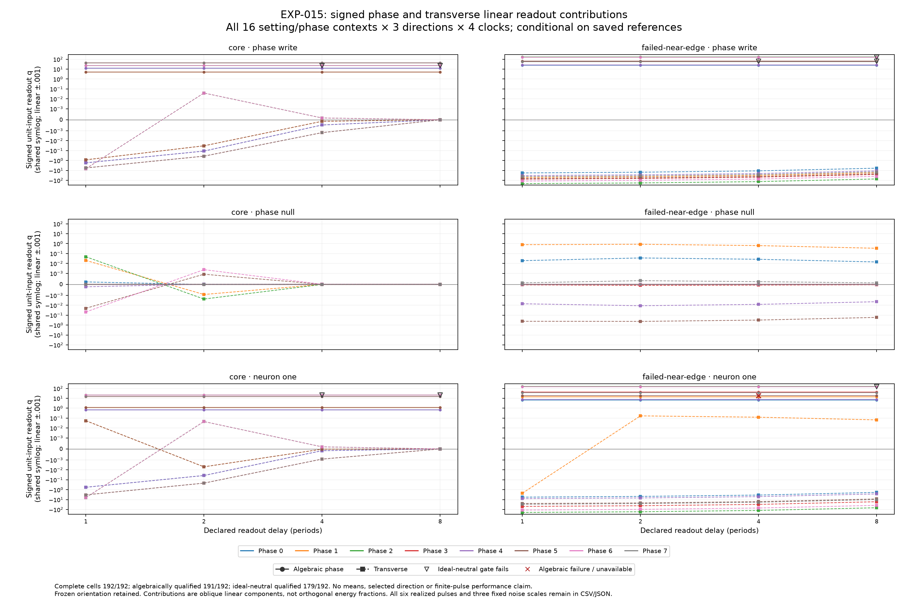

# EXP-015: a transverse channel contributes to the clock readout

17 September 2026. All **192 saved-reference cells** and **1,152 realized-pulse compatibility rows** complete. Under the frozen producer checks, the algebraic decomposition qualifies in 191 cells and the additional ideal-neutral approximation qualifies in 179. All 64 phase-null cells pass those checks. A separate independent arithmetic reconstruction retains strict discrepancies, including nine additional direct-propagation gate failures; it is not an overall strict-audit pass. These local linear results are conditional on the inherited reference and variational solution. They do not requalify either original EXP-014 setting or establish shrimp-specific computational utility.

The [frozen protocol](EXP-015-protocol.md) covers both settings, all eight phases, all three original input directions and all four clock windows. No new ODE, fitted decoder, finite-pulse comparison, selected winning direction or setting mean enters this analysis. All three noise diagnostics are retained. The geometry-derived phase gradient defines an oblique partition; the component norms are not additive energies.

## Mechanistic interpretation

A disturbance can change position along a cycle, change displacement away from it, or both. The fixed clock can observe both parts. The saved propagator separates these effects without changing the pulse or clock: its total response is the sum of the propagated phase-direction response and the complementary transverse response.

All 64 phase-null cells pass both kinds of frozen producer qualification. The null direction was constructed from the adjoint, so its near-zero timing projection is expected by design. Its initial phase displacement and algebraic timing contribution are nearly zero, while a transverse readout remains. The core readout strongly attenuates between the first and eighth windows; near-edge responses persist and can grow across sampled windows. These are local directional gains, not the nonlinear outcome of an actual norm-one perturbation.

Across all eight phases, the phase-null signed transverse unit-gain ranges are below. These are complete-stratum ranges, not means, task accuracies, monotonicity claims or a causally matched geometry comparison. Some early windows show transient growth or sign changes.

| Clock window (cycles) | Core transverse q range | Near-edge transverse q range |
|---|---:|---:|
| 1 | [-.0474441, .0474441] | [-.413075, .781507] |
| 2 | [-.00235367, .00235367] | [-.424979, .859268] |
| 4 | [-9.96540e-6, 9.96460e-6] | [-.311422, .629666] |
| 8 | [-2.93335e-9, 2.13806e-9] | [-.167229, .338122] |

The previously reported near-edge phase 1, phase-null, four-cycle example is retained for interpretation, not selected as a new endpoint. Its unit total gain is 0.629665942672, with zero algebraic phase contribution and transverse gain 0.629665942672. For the exact realized positive pulse of requested norm 1e-4, total q is 6.29665942679e-5, algebraic phase q is about 2.606e-15, and transverse q is 6.29665942653e-5. Its primary-noise standardized linear mean is 2.45676153; the negative pulse has the opposite sign. This accounts for the previously sealed full-linear prediction through transverse response. The prior observed analytic balanced accuracy of 0.9929902, compared with phase-only 0.5, belongs to EXP-014; it is not a new finite-pulse validation here.

The near-edge phase-writing direction also illustrates a readout consequence. Its algebraic timing contribution is positive at every phase/window, but the transverse contribution can outweigh it early: total linear q is negative at four of eight phases in window 1 and three of eight in window 2, then none in windows 4 or 8. All sixteen early-window cells pass the frozen algebraic and ideal-neutral checks. Thus a pulse constructed to write positive phase can initially produce the opposite signed linear clock response. This is conditional on the saved propagator and the particular fixed readout; it is not a new finite-pulse accuracy result. Phase writing uses Z/||Z||, which is generally not the flow-tangent direction, so its transverse component is expected.

A stable cycle therefore supplies both a timing coordinate and a fading transverse response. Their forgetting rates and the readout's sensitivity matter for neural information retention. Generic oscillator dynamics already predict this mechanism. Boundary organization, incremental value of shrimp geometry and transfer to trained networks remain open.



The figure uses the original orientation and a shared symmetric-log axis. It preserves signed contributions, all phases and all failed cells; it is not an orthogonal energy plot.

## Every failed gate remains visible

| Failed criterion | Setting | Phases | Directions | Delays | Cells |
|---|---|---|---|---|---:|
| Ideal-neutral approximation | Core | 2, 6 | Phase writing, neuron one | 4, 8 | 8 |
| Ideal-neutral approximation | Near edge | 1 | Phase writing | 4, 8 | 2 |
| Ideal-neutral approximation | Near edge | 6 | Phase writing, neuron one | 8 | 2 |
| Strict unit state partition | Near edge | 5 | Neuron one | 4 | 1 |

All 1,152 original full-linear compatibility records pass. The single algebraic failure is the unit-direction state partition: maximum absolute residual 7.38964445e-13, maximum elementwise tolerance ratio 2.43937448 under the unchanged atol=1e-14, rtol=1e-12 rule. It remains a failure; its realized-pulse compatibility passing does not override it.

The twelve other cells fail the ideal-neutral approximation only for the largest realized pulses, requested norm .01, in both signs. Their propagated-neutral state or activation discrepancy exceeds the frozen criterion. All scalar readout approximation checks pass, with maximum primary-noise standardized discrepancy below .008735 versus the .01 limit. Physical-flow versus template-derivative defects pass. Keeping these diagnostics separate prevents a small readout discrepancy from hiding state disagreement.

## Execution and evidence

The exact reviewed code and plan were privately pushed before calculation at source **e62b1dac4291c8aca288b723c70aea85259800d1**. Plan SHA-256: **6bc005d773af7aa60d3f8c2e7b85a97db6ddb70909815bbd787ea64fa54716e1**. Preflight passed 71 integrated synthetic tests and 413 independent metadata checks. The independent mathematical, adapter and controller review closed all findings before execution.

The complete analysis took **9.950 seconds** on one CPU thread, with no child workers or GPU. Sampled peak owned RSS was 206,123,008 bytes; available host RAM stayed at least 77,833,666,560 bytes. All 395 raw artifacts, totaling 67,014,834 bytes, are retained. Frozen saved-array verification replays all 192 cells and passes; the producer identity is absent after completion. Passing replay reproduces the recorded scientific failures.

The independent raw-array auditor passes **240,153 evidence and recorded-decision checks**, with zero failures. It decodes original and current packets independently, checks all byte bindings and reconstructs the recorded gate decisions from saved operands. Separately, SciPy Hermite interpolation, explicit matrix-vector products and compensated readout sums produce **2,917 strict numerical discrepancies** and **2,174 categorical differences**: 2,162 residual-location coordinates and twelve direct-propagation Boolean differences across ten cells. Nine originally algebraically qualified cells fail the alternate direct-propagation comparison. The maximum compared array discrepancy is 3.11275e-10. This is not an overall independent strict-arithmetic pass; the same rtol=1e-12, atol=1e-14 tolerances remain unchanged. Alternative arithmetic does not rewrite the original flags or establish independent solver accuracy.

A separate companion audit independently recomputes all 3,456 approximation gates across the 1,152 realized pulses, with **zero changed classifications** and the same 24 failed pulse/window rows. Maximum realized-response discrepancies are 3.15126e-12 in state, 2.83440e-13 in activation, 6.85563e-14 in q and 2.67485e-9 in primary-noise standardized q. These observational-scale agreements do not waive the strict arithmetic failures.

The separate saved-result interpretation passes 11,145 checks. Its original prose incorrectly said that phase-writing transverse contributions oppose the phase contribution in every cell. The retained erratum corrects that statement: it holds at all near-edge phase-writing windows and core window 1, with small positive core contributions at some later windows. The numerical tables are unchanged. A report/export helper verifies the complete census and all 395 raw artifact hashes; its 16 synthetic tests pass. The actual six-panel figure was visually checked. These reporting checks are distinct from independent raw arithmetic.

An initial invocation used a relative plan path that the source guard rejected before creating an attempt directory, decoding the sealed numerical input bundle or calculating any cell. Source/input validation had already hashed the original files. It is preserved in the compact receipt. Retrying with the absolute plan path changed no source, plan, resource limit or scientific choice.

Raw evidence: `/data2/neural-shrimp-data/raw/EXP-015/attempt-001`. Raw receipt SHA-256: **502a2613b7bac2704a7f93030d0450d7ae7a501c8c9dd8c8a47114dfac30c986**. Use the original frozen source in a separate clean checkout, with its source dependencies and original inputs available, to replay:

```bash
OPENBLAS_NUM_THREADS=1 OMP_NUM_THREADS=1 MKL_NUM_THREADS=1 \
NUMEXPR_NUM_THREADS=1 VECLIB_MAXIMUM_THREADS=1 BLIS_NUM_THREADS=1 \
.venv/bin/python tools/run_phase_transverse_gain.py verify \
  --directory /data2/neural-shrimp-data/raw/EXP-015/attempt-001
```

The machine plan, [local review](EXP-015-local-review.json) and [compact summary](EXP-015-summary.json) retain all exact bindings. Source and receipts are private Git backups; sibling raw storage is not an independent backup.

## Next decision

Independently qualify the full tangent solution before a broader utility claim.
The [bounded next design](independent-tangent-qualification-next-design.md)
retains all sixteen contexts and proposes two independently implemented methods
through eight periods, giving 32 complete state-plus-tangent jobs. Distinguish
cross-solver error, inherited-versus-direct propagation, and accumulated error
from repeated one-period composition. Keep the original clocks, directions,
projectors and failed gates. This design has not been implemented or executed;
it still needs executable tests, review and a private freeze.

A new presentation of the old phase-only/full-linear pulse comparison would
largely repeat EXP-014. An explicit odd/even nonlinear remainder study could
add information later. Matched geometry controls, complete boundary
organization and trained-network transfer remain separate research needs.
