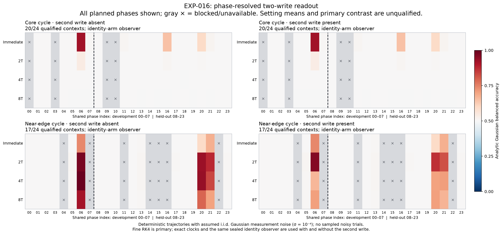
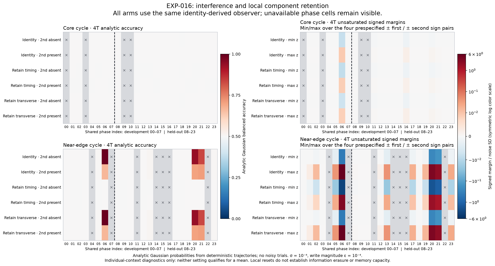

# EXP-016: readable memory and interference, with an incomplete phase cohort

17 September 2026. Exploratory pilot in the selected fixed-weight, three-neuron
tanh network. [Frozen protocol](EXP-016-protocol.md),
[machine receipt](EXP-016-summary.json).

**Human-friendly TLDR:** At some tested starting points near the edge, the
network retains a readable trace of the first input for several cycles. A
second input can substantially interfere with that trace: one checked example
falls from about 93.5% to 70.0% decoding accuracy. Keeping deviations away from
the cycle preserves this signal; keeping only its timing shift leaves this
observer near chance. The available core cases become unreadable much faster
to this observer. This is evidence for a
memory–interference tradeoff in particular cases, but numerical reference
failures prevent an average comparison across the full phase cohort. Ordinary
linear dynamics explain the completed examples closely; a special advantage
from shrimp geometry remains unproven.

## What ran and what failed

The code and complete plan were privately frozen at
`9904368b7b13721292efdc84dcf31efd7add30c7` before new neural outcomes. Both
settings use the same 24 randomly drawn starting phases, with eight development
and sixteen held-out indices. There is no decoder fitting on either split.
All 96 direct state/tangent reference jobs completed. Eleven of the 48 contexts
failed the unchanged phase-normalization gate, blocking their 621 planned
finite-input trajectories. All other 2,079 trajectories completed. The study
therefore remains **incomplete and unqualified**, despite orderly execution
and a complete ledger of all 2,796 planned jobs.

Every context passes the two-method state, activation, full tangent,
composed-response, observer-margin and probability reference checks. The sole
failing reference criterion is the consistency of the inherited phase gradient
with the physical flow, `abs(z dot f - 1) <= 1e-7`. Failed context indices are
core 0, 3, 9, 10 and near-edge 4, 7, 11, 14, 15, 16, 22. The largest residual
is approximately 5.9443e-7 across both methods' event flows; the primary
event-flow maximum is 5.9309e-7. Every initial normalization check passes;
all eleven failures occur at the one-period event. These failures were retained without renormalizing
the gradient, relaxing the threshold or replacing missing phases.

All 1,080 available trajectory-method comparisons pass; 324 remain unavailable.
The setting-wide means and primary contrast are withheld. Fourteen of sixteen
held-out core contexts and eleven of sixteen near-edge contexts are available.
Assigning each unavailable phase its full possible accuracy range gives the
frozen edge-minus-core bounds **[-19.2052, +24.5448] percentage points**.
This interval is a missing-data bound, not a confidence interval, and does not
establish the direction of the cohort effect.

## What the completed cases say about network behavior

All accuracies below are analytically calculated probabilities under independent
Gaussian observation noise, standard deviation 1e-4 per activation sample.
They describe a fixed linear observer that knows starting phase and elapsed
time, with a calibrated noiseless reference. They are not empirical noisy-trial
success rates, total memory capacity or performance of a trained network.
The two inputs have state-displacement magnitude 1e-4, separated by one period.

The following held-out phase-20 example is selected **after seeing the results**
to illustrate interference. Its individual context qualifies, while both
setting-wide cohorts remain unqualified. At four periods after the first input:

| Setting / intervention at the second input | First-input accuracy, second absent | First-input accuracy, second present |
|---|---:|---:|
| Core, original state retained | 50.0022% | 50.0022% |
| Near-edge, original state retained | 93.4750% | 69.9554% |
| Near-edge, timing component retained | 50.0002% | 50.0000% |
| Near-edge, transverse component retained | 93.4747% | 69.9553% |

The near-edge signal remains readable in this example, but the second input
costs about **23.52 percentage points**. At eight periods its corresponding
accuracy is 79.16% without the second input and 70.33% with it. The intervention
comparison connects the measured signal to deviations transverse to the cycle.
The operators are local oblique projections; they can amplify or reformat
state. Chance performance of the fixed observer after an intervention does
not prove that every possible decoder has lost all information.

Phase matters strongly. Among the **eleven available** held-out near-edge
contexts, four-period accuracy with the second input ranges from roughly
50.0001% to 70.8818%. The fourteen available core contexts range from roughly
50.0000% to 50.0046%. These are descriptive ranges of an incomplete panel,
not substitute setting means.



A weak immediate readout can later strengthen,
so raw perturbation decay alone does not determine readability at every time.

The full linear-response prediction tracks balanced accuracy in these examples
closely. At four periods, its largest with-second balanced-accuracy discrepancy
in the available held-out near-edge identity panel is about 2.565e-7 in
probability. This is not a bound on each sign combination: opposing errors
partly cancel in the balanced average. The largest individual sign-probability
discrepancies are about 0.000949 at four periods and 0.001423 at eight periods.
A simple dominant-mode model
also agrees at four and eight periods, but can miss the earlier two-period
response: in phase 20 it predicts 69.26% instead of the observed 86.57%, while
the full linear response predicts 86.57%. Thus short-lived additional dynamics
matter early, and a simple slow mode explains much of the later persistence.
This does not require a new nonlinear computational mechanism or demonstrate
an incremental benefit of shrimp-shaped parameter geometry.



## Verification, resources and provenance

The frozen verifier successfully reconstructs the saved analysis and preserves
`complete=false`. A separate checker, written by the evaluation implementation's
author with a different probability calculation and without producer imports,
passes 247,693 identity, gate and arithmetic checks with no disagreements.
This is an algorithmic cross-check, not independent scientific review; it
takes the sealed observers and reference prerequisites as inputs. Its maximum
strict arithmetic difference is approximately 1.066e-14. A separate diagnosis
examines the failed phase references; its [saved-evidence diagnosis](EXP-016-reference-diagnosis.md)
passes 14,981 checks and localizes all eleven failures to the intervention time.
The [EXP-017 protocol](EXP-017-protocol.md) fixes a reference-only follow-up.

Raw evidence remains at
`/data2/neural-shrimp-data/raw/EXP-016/attempt-001`. The receipt binds 6,649
artifacts totaling 3,015,098,986 bytes. Receipt SHA-256:
`5bb1ce4aa6e3934af04049853b621628ab9cf86e36a6b4091db75b01211f47ef`.
Plan SHA-256:
`f9b9b2e5052bea79a4a4eae5273e7496468c7211fbf42dd5fcbf535e12ac2e71`.
The source postflight is unchanged, and all original owned process identities
are absent after completion. The run used four CPU workers with numerical
library threads bounded to one. The GPU path was slower and failed numerical
qualification in the earlier EXP-012 preview benchmark. No EXP-016 GPU benchmark
or paid compute was used.

The [Astra Pro consultation](consults/2026-09-17-pro-adjudication.md) that
motivated this task completed for a conservative receipt-derived **[amount redacted]**,
within the authorized [amount redacted] limit. No additional generating call was made.

Replay from the frozen source environment:

```sh
OPENBLAS_NUM_THREADS=1 OMP_NUM_THREADS=1 MKL_NUM_THREADS=1 \
NUMEXPR_NUM_THREADS=1 VECLIB_MAXIMUM_THREADS=1 BLIS_NUM_THREADS=1 \
.venv/bin/python tools/run_two_write_memory.py verify \
  --attempt-dir /data2/neural-shrimp-data/raw/EXP-016/attempt-001
```

## What remains

Diagnose the inherited phase-reference normalization before a separately
frozen follow-up. Keep all 48 contexts, the original failed attempt, unchanged
scientific thresholds and the complete missing-phase accounting. Any corrected
reference or repeated neural study requires a new recorded amendment and
pre-outcome freeze. Full shrimp boundary organization, matched tests of
geometry's additional value, and transfer to trained networks remain distinct
research questions. External raw storage still needs an independently verified
backup; private Git protects the code and receipts.
