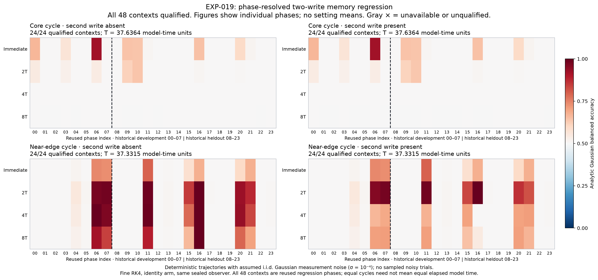
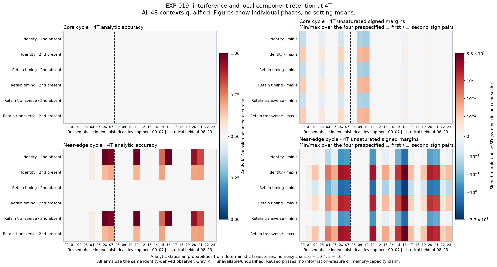

# EXP-019: complete phase census confirms memory and readout interference

17 September 2026. All 2,796 jobs complete, all 48 contexts qualify and all
1,404 numerical comparisons pass. Both setting means and the planned primary
contrast are available. This is an exploratory regression on reused phases.

**Human-friendly TLDR:** In this fixed-weight three-neuron network, the selected
near-edge cycle can retain a readable input for several cycles, while the core
has almost forgotten it by four cycles under the tested readout. A second input
substantially interferes with that readout. The average benefit is modest and
strongly phase-dependent: a few starting phases retain much more readable
memory than the others. This establishes a behavioral consequence of the
selected dynamics, not a benefit unique to shrimp geometry or trained networks.

## The complete memory comparison

The primary comparison uses the original sixteen paired phase indices 08–23.
Their `heldout` label is historical: these phases have been reused, so they are
not fresh validation cases. All 24 phases in each setting were acquired and
had to qualify; no failed phase was discarded to obtain these averages.

| Four-cycle first-input balanced accuracy | Core | Near edge |
|---|---:|---:|
| No second input | 50.0077% | 62.8989% |
| Unknown balanced second input present | 50.0077% | 55.0540% |
| Loss associated with the second input | 0.000006 percentage points | 7.8450 percentage points |

The near-edge-minus-core primary contrast is **5.0463 percentage points**.
The frozen 20,000-draw paired-phase bootstrap gives a central interval of
**1.3677 to 9.5264 percentage points**. This describes variation across the
reused phase cohort, conditional on two selected cycles. It is not a fresh
confirmatory interval, a population-of-networks result or a significance claim.

These accuracies are analytic Gaussian readout probabilities from deterministic
trajectories, with known starting phase, a calibrated noiseless baseline and
independent measurement noise sigma=1e-4 per activation sample. They are not
empirical hit rates from sampled noisy trials. Both writes have magnitude
1e-4 in the fixed phase-null direction. The observer was sealed from unforced
references before any finite-input trial and was never fitted to their results.

| Near-edge identity readout, same sixteen reused phases | No second input | Second input present |
|---|---:|---:|
| Window ending at 2T | 63.5750% | 62.6962% |
| Window ending at 4T | 62.8989% | 55.0540% |
| Window ending at 8T | 59.7378% | 54.8770% |

The periods are 37.63637538 model time units at the core and 37.33149959 near
the edge. Four cycles therefore end at 150.5455 and 149.3260 model time units.
The budget is 32 samples per cycle; this is not an equal-elapsed-time or
equal-bandwidth comparison. Different windows and sealed observers also mean
that nonmonotone accuracy is not evidence of information creation or a simple
monotone forgetting law. The immediate window precedes the second write.

## What carries the effect, and what the readout misses

At 4T, retaining the transverse component gives near-edge averages of 62.8989%
without the second write and 55.0575% with it, closely preserving the identity
result. Timing-only retention gives approximately 50% in both conditions.
Every arm uses the same identity-derived observer. These local oblique resets
can amplify or reformat state differences; they are not orthogonal energy
partitions or proof that all information has been removed.

The post-hoc phase-16 example is particularly informative. Its no-second
accuracy rounds to 100%, but a second write reduces the fixed linear readout
to **50.3095%**. Other phases remain useful: phase 11 changes from 98.9523% to
67.4450%, phase 20 from 93.4750% to 69.9554%, and phase 21 from 83.5392% to
70.8818%. These examples illustrate the complete census rather than replace it.
Chance performance of this observer does not establish that a nonlinear
observer could not recover the earlier bit.

Full-linear predictions explain the phase-resolved balanced scores closely.
Across all 48 contexts, three arms and four windows, their largest balanced
accuracy discrepancy is 0.1722 percentage points at near-edge phase 16,
transverse arm, 8T. Accuracy averaging can conceal larger per-sign errors:
for historically held-out near-edge identity cases, the largest per-sign
probability difference at 8T is 0.9416 percentage points, while the largest
balanced-score difference is only 0.01684 percentage points. Do not describe
agreement of balanced scores as agreement of every signed response.

The single-transverse-mode approximation misses early behavior: at 2T its
near-edge identity mean with a second write is 54.0188%, versus 62.6962% for
the finite trajectories and the full-linear model. It agrees closely with the
balanced scores at 4T and 8T. Thus one slow decay rate is insufficient for the
early readout; the full local dynamics and observation direction matter.
The refined dominant transverse amplitudes retain about 6.5% per cycle at the
core and 85.6% near the edge, providing a local explanation for their different
persistence without establishing a geometry-specific advantage.

## Numerical qualification and separate audit outcomes

All 96 fresh eight-period reference jobs and all 48 observer/context seals
passed the persisted global barrier before any of the 2,700 finite traces
started. All 1,296 coarse/fine and 108 independent-panel comparisons pass.
Maximum state, activation, standardized-margin and probability disagreements
are respectively 3.6801e-9, 2.2763e-9, 1.3503e-5 and 5.3870e-6, below the
unchanged limits 1e-6, 1e-7, .01 and .001.

The frozen saved-array verifier reproduces the result and confirms all original
owned worker identities are absent. A standalone finite/statistics audit passes
808,668 identity, arithmetic and gate checks, reconstructing scores, controls,
setting means and the bootstrap. Its author wrote the acquisition/runtime and
new adapter, but not the evaluator; this is an algorithmically separate audit,
not an independent acquisition-author review. A separate root score-to-summary
check passes 27,128 checks with maximum arithmetic difference 8.89e-16.

The independent reference/observer audit passes all 26,422 identity/evidence
and 1,153 gate checks. Its strict alternate-arithmetic lane fails 165 of 9,408
comparisons, involving 2,696 elements; no tolerance is changed. The largest
difference, 7.399e-7, is a normalized observer coordinate when the long-horizon
core signal is tiny, not a state-trajectory error. On identical frozen A/B,
the alternative observer formula agrees within 5.15e-15 in its unit vector;
even applying the independently repropagated observer to the frozen responses
changes standardized margins by at most 4.49e-14. All categorical gate decisions
agree. The strict arithmetic failures remain failures, and this lane is not
reported as an overall pass. This reviewer authored the controller but not
the scientific acquisition/evaluation kernels.

## Reproducibility and the next question

The [protocol](EXP-019-protocol.md), [local review](EXP-019-local-review.json),
complete plan and tested code were privately pushed before acquisition at
`7eeba42182184a209dbc2f718e8469a5cd97e4a9`. Plan SHA256:
`86ae6924a1a89c1d8ae878742f0b012680443fa2cad8746c1853a52d4b6c0543`.
Preflight covers 80 distinct tests. The new figure helper passes 29 tests and
both rendered figures were inspected.

The four-worker CPU run takes 333.69 seconds. All 5,592 planned segment calls
complete. The 8,513 raw artifacts total 3,720,153,105 bytes; sampled owned RSS
peaks at 578,871,296 bytes, counting shared pages in each process. No GPU,
paid compute or additional Pro call is used. The earlier preview GPU benchmark
was not a benchmark of this memory workload.

Immutable raw evidence is at
`/data2/neural-shrimp-data/raw/EXP-019/attempt-001/`; receipt SHA256:
`ef9d6020c6c13f3b7ea89fddff4c4eabb112275c6c8b98724f2e56d0735c5001`.
The [compact summary](EXP-019-summary.json) binds audits, raw inventory,
resource observations and figures, and retains all phase-balanced results.
Earlier EXP-016/017 failures remain unchanged. Code, receipts and selected
figures are privately backed up; bulky raw data remain outside Git.

Next, a separately frozen exploratory analysis will test a reference-defined
nonlinear Gaussian-mixture readout across the full reused phase census. Its
purpose is to distinguish linear-readout interference from information that
remains recoverable after the second input. No nonlinear-readout result is
claimed here. Full shrimp boundary organization, matched controls for the
incremental value of geometry and transfer to trained networks remain open.
