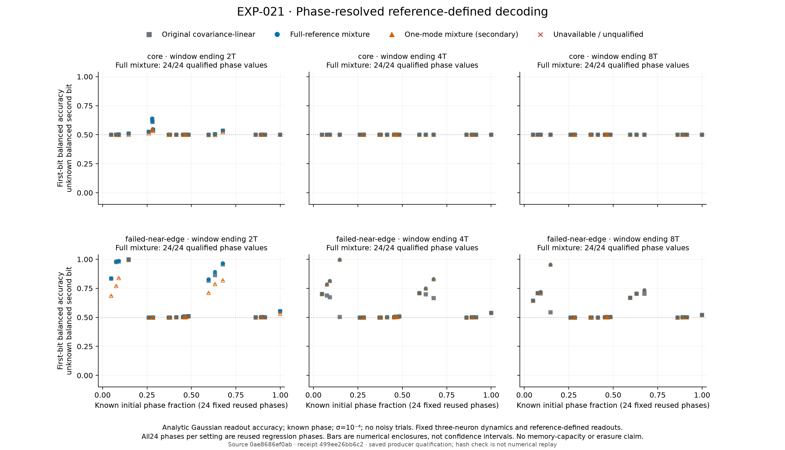
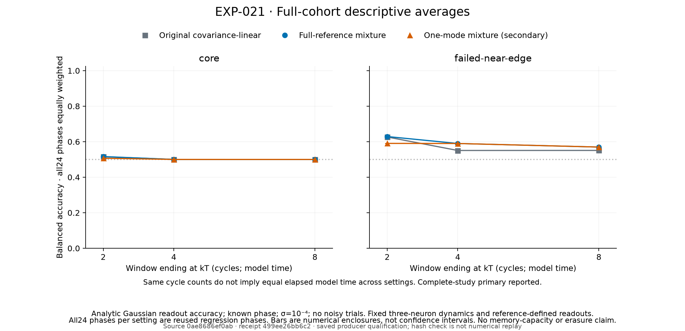

# EXP-021: nonlinear recovery of an earlier input

17 September 2026. Exploratory, outcome-informed numerical correction on the complete reused phase census. Frozen source `0ae8686ef0ab719bc7dcff300962aabd4a6679b9`; all 144 cells qualify. Frozen numerical replay and both separate saved-evidence audits pass.

**Human-friendly TLDR:** In the selected near-edge three-neuron cycle, an earlier input can survive a second input in a form that a linear observer misses. Four cycles later, changing only the readout raises mean first-bit accuracy from **55.05% to 58.98%** across all 24 phases. One previously identified phase improves from **50.31% to 99.69%**. The core cycle has already fallen essentially to chance. A simpler observer built from a one-mode reference is equally effective at these late windows. These results show persistent, recoverable memory without establishing that shrimp geometry uniquely causes it.

## Behavioral result over the complete cohort

Both selected cycles pass all 72 setting-specific cells. The frozen primary is the equally weighted nonlinear-minus-original-linear first-bit accuracy at 4T over all 24 near-edge phases, conditional on both settings passing. It is **3.9268 percentage points**, with a certified numerical interval of **[3.9253, 3.9327] points**. This interval bounds the declared probability calculation; it is not a confidence interval across new cycles, phases or networks. All phases were reused, and these are two selected fixed-weight three-neuron networks.

| Cycle | Observation window | Original linear accuracy | Full-mixture accuracy | Nonlinear gain |
|---|---:|---:|---:|---:|
| Core | 2T | 51.5386% | 51.6200% | 0.0814 points |
| Core | 4T | 50.0073% | 50.0073% | approximately zero |
| Core | 8T | 50.0000% | 50.0000% | approximately zero |
| Near edge | 2T | 62.6449% | 62.8904% | 0.2455 points |
| Near edge | 4T | 55.0547% | 58.9815% | 3.9268 points |
| Near edge | 8T | 55.0816% | 56.9753% | 1.8937 points |

T is each cycle's own period, in model time units. These means average balanced first-bit accuracy with an unknown, balanced second bit. The phase and calibrated baseline are known to every observer; no hidden second-bit label is supplied. Gaussian measurement noise has standard deviation 1e-4 in activation-observation units; the pulse amplitude is also numerically 1e-4, in state units. The trajectories themselves are deterministic saved EXP-019 simulations.

Recovery varies strongly with input timing. At 4T, five of the 24 near-edge phases have a gain interval wholly above zero; the complete all-phase mean includes the other nineteen. The previously selected phase 16 supplies the largest gain: 50.3095% linear versus 99.6905% nonlinear, with nonlinear numerical interval [99.6904%, 99.6941%]. It is an illustrative known case, not an independently selected success. The complete phase plot displays every phase.

Every phase, setting and window is shown. The plot retains the historical identifier `failed-near-edge`; all EXP-021 cells at this setting qualify. Its footer describes the figure generator's saved-data scope, while the independent audits below establish the additional verification. Full- and one-mode symbols overlap at late windows because their scores agree at the displayed precision.

The [figure receipt](EXP-021-figure-receipt.json) binds 432 phase/recipe rows, 18 mean/recipe rows, raw inputs and generator source. All points are calculated from saved evidence; no figure value is manually entered.

## What mechanism is supported?

Changing the readout while keeping the neural observations fixed recovers the earlier bit. A near-chance linear score therefore cannot establish that the network erased that input. It can reflect interference that requires a decision boundary with multiple regions.

At 4T and 8T, the full-mixture and one-mode nonlinear observers agree to about 2e-14 in accuracy at every near-edge phase. A one-mode reference is therefore sufficient to construct an equally effective late observer on these same full neural observations. This agrees with a simple readout explanation involving overlapping input amplitudes. It does not establish that the actual finite neural responses are scalar or that parameter-space geometry supplies additional computation.

Early behavior needs a richer description. At 2T, near-edge one-mode mean accuracy is 59.0364%, below the full-mixture 62.8904%; core one-mode mean accuracy is 50.6856%, below 51.6200%. Transient directions and their write/read orientations are plausible explanations for the earlier mismatch, but this decoder comparison does not uniquely identify them. An equally effective late observer should not be extrapolated backward to all windows.

The readout is Bayes-optimal for its sealed linear-reference mixture, not necessarily for the actual finite nonlinear class means. No classifier was fitted to those finite means. Success under this observer does not establish joint two-bit capacity, unknown-phase performance, noisy dynamical memory, trained-network transfer or a shrimp-specific advantage.

## Complete execution and preserved correction

The separately frozen successor evaluates the same 144 cells, 432 definitions and 4,704 mixture slots as EXP-020. All 4,704 mixture probabilities and all 1,728 auxiliary linear reference probabilities complete and qualify. The 624 primary and 624 one-mode solver comparisons, 576 alternate-reference comparisons, original-linear replay and balanced reference controls pass. All 432 definitions were serialized and reopened before finite observations were accessed.

EXP-020 remains incomplete: 304 nominal quadratures failed and its complete-study primary stays withheld. EXP-021 changes the small-signal nominal CDF arithmetic, adding recorded integration hints from synthetic testing. It retains the same exact input geometry, certificate algorithm, thresholds and full census. The prior failed study and the failed synthetic prototype are preserved. A successful new correction never retroactively qualifies either one.

Execution took **150.06 seconds** with four single-thread CPU workers, peaking at **938,065,920 bytes** sampled combined owned RSS. Worker CPU time was 404.62 seconds; the slowest cell took 17.15 seconds against a 30-second limit. All owned worker identities were absent after cleanup. The local raw bundle contains 1,170 artifacts totaling 204,203,771 bytes. No GPU, paid compute or additional Pro consultation was used. This scalar arbitrary-precision decoder has no validated GPU implementation; the older ODE GPU timing is a different workload.

## Validation and reproducibility

All 81 new core/controller/integration tests passed on the held source before execution. An independent numerical-core review passed 20 additional synthetic tests, including 126 direct-density point comparisons and three separately partitioned integral controls. The complete machine plan passed 541 root checks and 594 controller-author checks, with their authorship disclosed.

After execution, the frozen verifier recomputed all 144 cells and all 4,704 mixture calculations in 435.48 seconds. Completion, qualification, source bindings and owned-process cleanup matched. The controller author ran that verification; it is producer-code replay, not a second numerical implementation.

A separate saved-evidence auditor passed **269,133 checks** of physical A/B/baseline bindings, exact geometry and projections, old-score replay, new point-error diagnostics, full census and gate logic. Its maximum separate arithmetic discrepancy was 1.11e-16. Its author wrote earlier acquisition and the inherited evaluator, but this auditor imports none of those producers or the probability core. It performs no second arbitrary-precision integrated enclosure.

Root's independently written aggregation audit passed **13,212 checks**, using exact rational interval arithmetic and separately recomputed group/setting means. Maximum arithmetic difference was zero. This validates saved-score-to-summary arithmetic rather than independently reacquiring trajectories. The 24 saved-figure tests also pass; both figures were visually inspected. Exact audit receipts and source hashes are retained in the compact summary.

The [protocol](EXP-021-protocol.md), [machine plan](../experiments/hopfield/EXP-021-plan.json), [local review](EXP-021-local-review.json) and [compact summary](EXP-021-summary.json) bind the complete result. Raw evidence is `/data2/neural-shrimp-data/raw/EXP-021/attempt-001/`; receipt SHA-256 `499ee26bb6c2373905b7c8e76920ccf7bdba298fb8d43a03e741552ac681ff13`, raw summary SHA-256 `5323355659b807d754c25c2aa8731d92d69c9e218398325ea9df6a41bcd49b54`, plan SHA-256 `ea9a5f823a38a1d41e8d4f81c8890f3a73f56455c34e919ca50400efa620a6d6`. A sibling data directory is durable local storage, not an independently verified backup.

## Next question

The next useful comparison is between periodic cycles with measured contraction and observability, not another favorable example from these two cycles. A small, reference-only continuation panel can establish whether suitable controls exist before a new finite-write experiment. Full A/B response geometry already fixes the reference Gaussian prediction; any geometry-increment claim must define a different prediction or examine finite-dynamics residuals. Parameter-perturbation robustness may be a more direct consequence of window geometry, but it requires multidirectional boundary evidence. Neither the current two-setting comparison nor a single continuation transect verifies complete shrimp boundary organization.

The accepted next direction is specified in the [bounded cycle-reference design](next-cycle-reference-design.md), with unresolved implementation and freeze requirements clearly listed.
