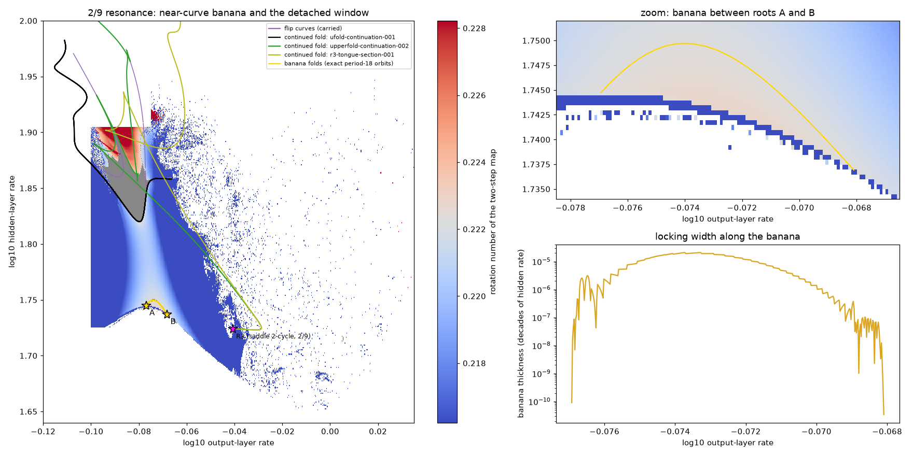

# How the period-18 window is organized (S2-28011)

Status: exploratory float64 numerics and one advisory consult; nothing here is
certified. Started 11 October 2026; revised the same day after orbit-level
continuation. Coordinates: x = log10 output-layer rate, y = log10 hidden-layer
rate.

## Question

The certified period-18 window lies about 0.07 decades above the period-2
Neimark-Sacker curve, and the window is 2/9 locking (period 18 = 2 x 9). Is it
the 2/9 Arnold tongue of the edge-of-stability 2-cycle, reaching the curve
through a thin neck at a 2/9 root? Or is it a resonance region detached from
the curve?

## Answer

**Neither picture is complete. The window is detached from the 2/9 locking of
the edge-of-stability cycle's attracting circle, but its period-18 family is
attached to the period-2 Neimark-Sacker locus elsewhere: at a 2/9 resonance of
a second, coexisting 2-cycle that is a saddle. That tongue is invisible to
attractor maps.**

1. **Closed banana at roots A and B.** The main 2-cycle loses stability through
   a supercritical Neimark-Sacker bifurcation. Its birth rotation along the
   curve has a local maximum of 0.2228, between two 2/9 roots,
   A = (-0.0769, 1.7447) and B = (-0.0681, 1.7369).
   - The circle's 2/9 locking region is a closed banana. Its two fold curves
     run from A to B, and it holds exact primitive period-18 orbits.
   - It rises at most about 0.005 decades above the curve, and its thickness
     peaks near 2e-5 decades of hidden rate.
   - This is the geometry of Peckham, Frouzakis and Kevrekidis (1995).
2. **Rotation valley.** Above the banana, the circle's rotation falls below 2/9
   in every column. The highest column minimum is 0.22043 at
   (-0.0766, 1.792). It then rises back to 2/9 at the window's lower boundary.
   So no path from the banana to the window keeps the circle locked.
3. **The window's lower boundary is a closed fold loop with two cusps.**
   - The loop's bottom is a smooth U at (-0.0800, 1.8200), where the period-18
     node-saddle pair is born on the main cycle's attracting circle.
   - From there the loop runs up the right arm to a cusp near
     (-0.0664, 1.858), back through the window as an internal fold, up to a
     second cusp near (-0.114, 1.97), and down the left arm.
   - It never comes down toward the curve. This matches the "U-shaped
     saddle-node outline plus internal saddle-node with a cusp" of Varga,
     Klapcsik and Hegedus (2019).
4. **The upper boundary belongs to a hidden 2/9 tongue.**
   - The certified canonical fold, with the certified 1:1 point and cusps A
     and B on its continuation, continues through non-attracting period-18
     orbits. It descends to R3 = (-0.040625, 1.723958), where the orbit
     collapses onto a period-2 orbit.
   - That 2-cycle has two-step multipliers 1.03098 (a saddle direction) and
     0.17365 +- 0.98481i. The pair has modulus 1 to within 4e-11, at
     0.2222222226 turns (2/9 to within 4e-10).
   - It is not the main 2-cycle. The main cycle's Neimark-Sacker locus passes
     0.04 decades below R3, with rotation 0.2135 there, and that cycle stays
     0.78 away in state space.
   - The tongue rooted at R3 is extremely thin near its root: 1.3e-8 decades
     wide about 9e-4 decades from R3.
   - Both of its folds rise into the window region. The second fold bounds an
     attracting part of the window between (-0.0619, 1.8316) and
     (-0.0785, 1.8973).
5. **The window is where the hidden tongue becomes attracting.**
   - The tongue's locked orbits inherit the saddle cycle's unstable
     direction: multiplier 1.03098^9 = 1.316 at R3.
   - Tracked along the upper fold, that real multiplier stays above 1 until
     it crosses +1 at two 1:1 resonance points. One is the certified 1:1
     point; the other, near (-0.0957, 1.9247), is not certified.
   - Between those points it is about 0.8, and the cycle is attracting.
   - The certified Neimark-Sacker branch emanating from the 1:1 point is
     where the cycle trades stability with that inherited direction.
6. **One orbit family bridges two circles.** At fixed output rate through the
   certified attracting interval, the period-18 orbits form one node-saddle
   pair. It spans from the lower loop's fold (y = 1.832573) to the canonical
   fold (y = 1.878581). The attracting node sheet therefore joins locking on
   the main cycle's circle (bottom) to the saddle cycle's 2/9 tongue (top).

In short, the window is the attracting part of a period-18 family that is
born on the edge-of-stability cycle's circle at the U, and that is also the
upper end of an Arnold tongue rooted at a hidden resonance of a coexisting
saddle cycle. The 7 October descent from the window ("narrows much faster
than delta^3.5, then the tracker stalled") was meeting the bottom of the U.
Attractor-only maps cannot see the R3 tongue, because its orbits are
non-attracting until they enter the window.

Figure: `composite-001` (copy in `docs/figures/`). Left: both rotation maps (grey = locked at 2/9), the banana folds (gold), the lower fold loop (black), the canonical fold descending to R3 (green), the R3 tongue's second fold (olive) and carried flip curves (purple). Right: zoom on the banana and its locking width.

## What theory says

- **Detachment is allowed.** No theorem forces a locking region to reach a
  Neimark-Sacker curve. For example, the circle family
  `theta + p/q + d(s,t) + a sin(2 pi q theta)` with `d = a/2 + s^2 + t^2` has
  a closed locking disk and no Neimark-Sacker curve at all.
- **Closed bananas attached at two roots** arise where the birth rotation along
  the curve has an extremum (Peckham, Frouzakis and Kevrekidis 1995).
- **Rotation maps see only attractors.** Unstable branches can connect
  attracting windows that look separate, as the R3 tongue does here.
- **Reconnection.** If a third parameter (for example the ridge coefficient)
  joined the banana to the window, the generic event would be a Morse saddle
  of the fold surface: the projected fold curves are hyperbolas that exchange
  connectivity, and no cusp is needed.
- **Nontwist is an analogy only.** The rotation is non-monotone in distance
  from the curve. That resembles nontwist shearless behaviour
  (del-Castillo-Negrete, Greene and Morrison 1996), but it is not the same
  property.
- **Why the window may be wide (phase model).** With slowly varying detuning
  `delta` and resonant amplitude `a_q`, the locking width along a direction
  `n` is about `2|a_q| / |d_n delta|`. The circle's rotation stays within
  about 0.005 of 2/9 across this whole region.

## Evidence

| Item | Result | Where (`../neural-shrimp-data/explore/window-organization/`) |
|---|---|---|
| Rotation maps (361 x 361 below the window; 321 x 441 on the right) | Banana arc, valley, window region | `rotation-gap-361`, `rotation-right-441`, `anatomy-002` |
| Circle check at the U bottom | The fold orbit lies on the main circle (distance proportional to offset); rotation rises to 2/9 from below | `circle-check-001` |
| Banana orbits (fastcont, float64 single shooting) | Exact period-18 orbits; locking interval 1.54e-5 decades at x = -0.0745; both folds run from A to B | `banana-0745` |
| Lower fold loop | Closed loop with two cusps; lowest point 1.8200 | `ufold-continuation-001` |
| Upper (canonical) fold | Reproduces the certified 1:1 point and cusps; descends to R3 | `upperfold-continuation-001/002` |
| Period-2 orbit at R3 | Saddle 2-cycle with a 2/9 pair on the unit circle | `collapse-period2-001` |
| Main cycle's Neimark-Sacker locus; main cycle continued to R3's rates | Passes below R3; a different cycle | `ns2-locus-001`, `main2cycle-to-r3-001` |
| R3 tongue's second fold | Width 1.3e-8 decades near R3; rises into the window | `r3-tongue-section-001` |
| Section through the certified attracting interval | One pair spanning the lower-loop fold and the canonical fold | `canonical-section-001` |
| Pro consult and adjudication | References verified; orbit-level caution adopted (and borne out) | `docs/consults/2026-10-11-window-organization/` |

Code: `src/neural_shrimp/fastcont.py` (tests `tests/test_fastcont.py`,
including recovery of a carried fold node) and
`tools/explore_window_organization.py`. The run cards are in
`docs/research-log.md`.

## Not yet established

1. **Certification.** None of this is certified. A certificate for the R3
   collapse (the fold curve ending at a 2/9 resonance of the saddle cycle) and
   for the section result (one pair between the two folds) would turn the
   orbit-level link into a theorem.
2. **The second 2-cycle.** Where does the saddle 2-cycle come from (a period-2
   fold? another branch?), and what does its Neimark-Sacker locus look like?
3. **Other components.** The near-curve 2/9 roots far away, at
   (+0.0112, 1.6809) and (-0.4267, 1.8709), have not been traced, and neither
   have the loop's codimension-two candidates: a second multiplier within
   1e-3 of +1 near (-0.1072, 1.9137), and a multiplier within 3.3e-3 of -1
   near (-0.0761, 1.8534).
4. **Inside the window.** The unstable skeleton (saddle-to-node arcs) and
   where the locked circle breaks down.

## References

- B. B. Peckham, C. E. Frouzakis, I. G. Kevrekidis, "Bananas and banana
  splits: a parametric degeneracy in the Hopf bifurcation for maps", SIAM J.
  Math. Anal. 26 (1995) 190-217.
- B. B. Peckham, "The necessity of the Hopf bifurcation in families of
  periodically forced oscillators", Nonlinearity 3 (1990) 261-280.
- D. G. Aronson, M. A. Chory, G. R. Hall, R. P. McGehee, "Bifurcations from an
  invariant circle for two-parameter families of maps of the plane: a
  computer-assisted study", Commun. Math. Phys. 83 (1982) 303-354.
- D. del-Castillo-Negrete, J. M. Greene, P. J. Morrison, "Area preserving
  nontwist maps: periodic orbits and transition to chaos", Physica D 91 (1996)
  1-23.
- F. Varga, K. Klapcsik, F. Hegedus, "Route to shrimps: dissipation driven
  formation of shrimp-shaped domains" (2019, preprint; see
  `docs/plans/s2-period18-boundary-curves.md` for the source).
- Y. A. Kuznetsov, *Elements of Applied Bifurcation Theory*, 3rd ed.,
  Springer (2004).
